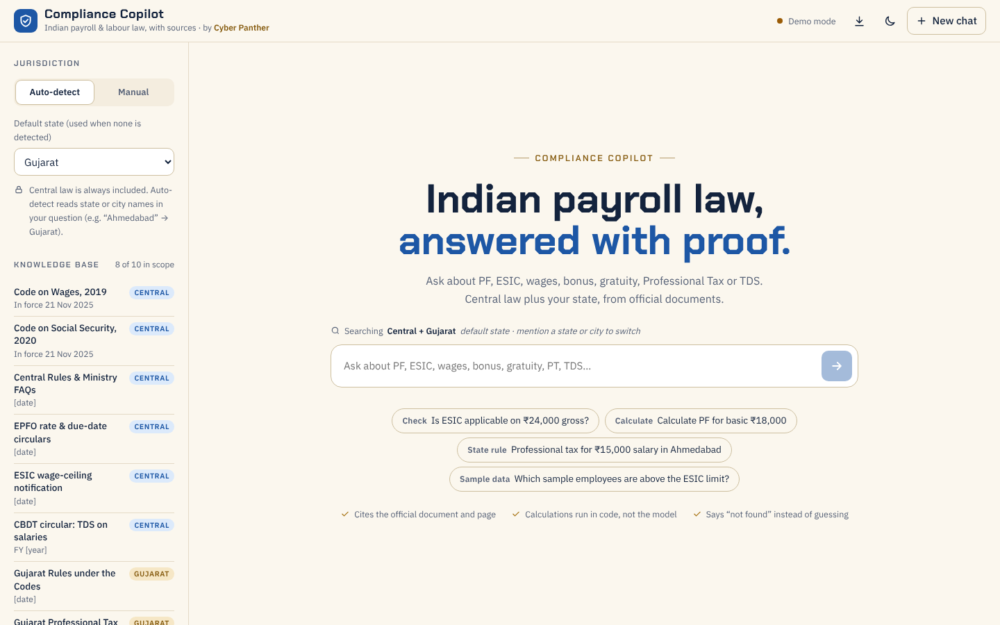
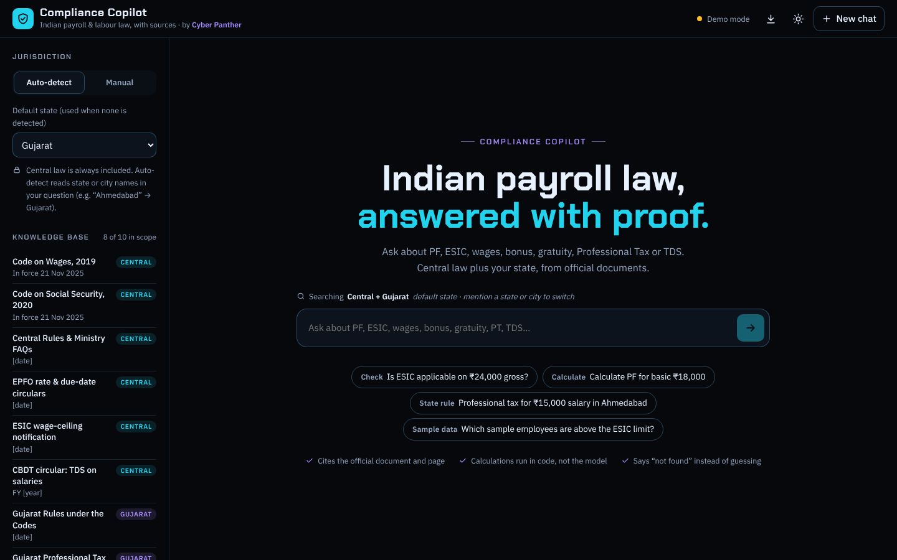
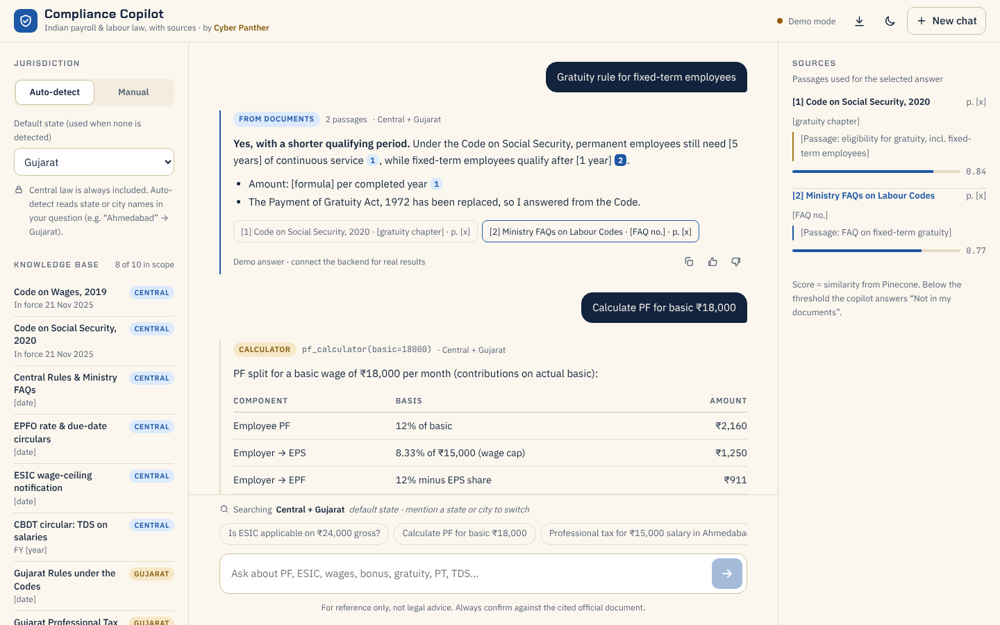
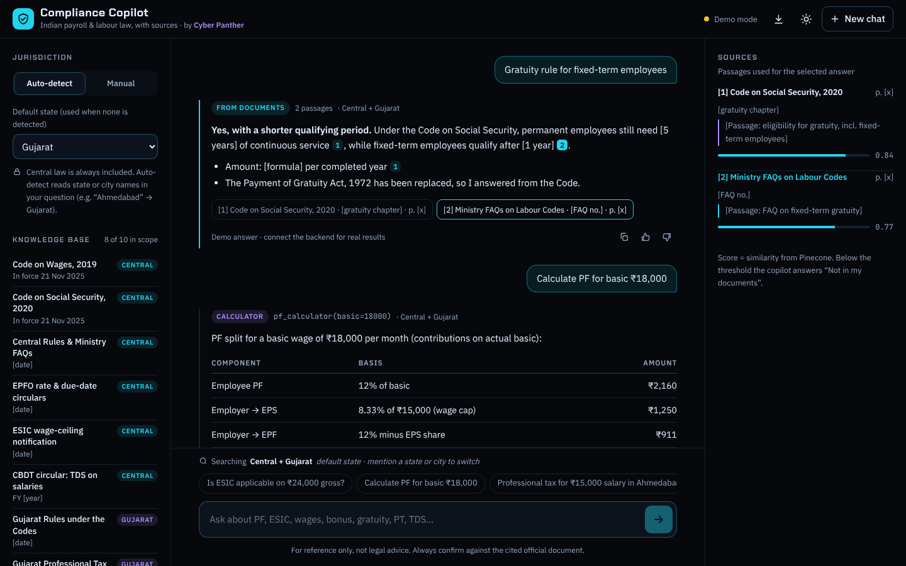
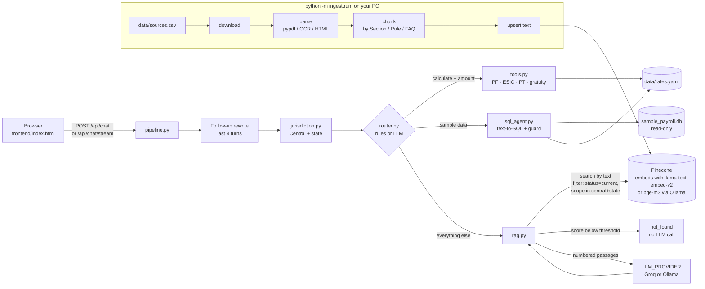

# Compliance Copilot

**Ask Indian payroll and labour-law questions and get answers cited to the official Gazette and India Code documents.**

**Live demo:** https://compliance-copilot-pykf.onrender.com (free server: the first visit after 15 idle minutes takes up to a minute to wake up)

[](https://render.com/deploy?repo=https://github.com/rushimakwana112-cpu/compliance-copilot-india)

Try asking:

1. *Who is eligible for gratuity under the Code on Social Security?*
2. *What is the definition of wages under the Code on Wages?*
3. *Is overtime paid at a higher rate than ordinary wages?*

| Light theme | Dark theme |
|---|---|
|  |  |
|  |  |

A portfolio project by **Cyber Panther**, built as a Learnbay assignment. India's four Labour Codes came into force on 21 Nov 2025 and replaced the EPF, ESI, Gratuity, Bonus and Minimum Wages Acts, so a general chatbot trained on older text answers confidently and wrongly. This copilot answers only from the documents below, shows the passage and page it used, and says *"not in my documents"* instead of guessing.

> **Not legal advice.** Answers are for reference only and can be wrong or out of date. Always read the cited official document, and consult a qualified professional before acting on it.

## How it works

1. **Jurisdiction.** Central law is always searched; a state or city in the question (for example "Ahmedabad") adds that state's rules.
2. **Routing.** A calculation ("PF for basic ₹20,000") goes to a Python calculator, a question about the synthetic sample employees goes to a guarded text-to-SQL agent, and everything else goes to retrieval.
3. **Retrieval.** Pinecone searches the indexed documents (hosted `llama-text-embed-v2` embeddings), filtered to current law and the right scope. Low scores end in "not found" without calling the model.
4. **Answer.** Groq's language model writes the answer from the numbered passages only and cites them; the page shows each citation with the document, section and page.

Statutory figures (rates, ceilings) are never hard-coded: they come only from the cited documents and from `data/rates.yaml`, where each figure carries its source and effective dates.




## Sources used

All documents are official and listed in [`data/sources.csv`](data/sources.csv); each answer cites the one it used.

| Document | In force | Link |
|---|---|---|
| Code on Wages, 2019 | 21 Nov 2025 | [India Code](https://www.indiacode.nic.in/bitstream/123456789/15793/1/aA2019-29.pdf) |
| Code on Social Security, 2020 | 21 Nov 2025 | [India Code](https://www.indiacode.nic.in/bitstream/123456789/16823/1/aA2020-36.pdf) |
| PIB explainer: Labour Codes in force | 21 Nov 2025 | [PIB](https://static.pib.gov.in/WriteReadData/specificdocs/documents/2025/nov/doc20251122702601.pdf) |
| Gazette: EPFO wage ceiling raised to Rs 25,000 | 17 Sept 2026 | [labour.gov.in](https://www.labour.gov.in/static/uploads/2026/09/2b0f1dbbd3769fc388416186ec145328.pdf) |
| Gazette: Implementation of Code on Wages, 2019 | 21 Nov 2025 | [labour.gov.in](https://www.labour.gov.in/static/uploads/2025/12/0fd090d29a4576739079a7b565c8ca9d.pdf) |
| Gazette: Implementation of Code on Social Security, 2020 | 21 Nov 2025 | [labour.gov.in](https://www.labour.gov.in/static/uploads/2025/12/b602569a9cd014c49d91472b6a22b24c.pdf) |
| Gazette: Implementation of Industrial Relations Code, 2020 | 21 Nov 2025 | [labour.gov.in](https://www.labour.gov.in/static/uploads/2025/12/3db01976470a13d7b54b0e6e410d42b8.pdf) |

The Industrial Relations Code and the Occupational Safety, Health and Working Conditions Code themselves are not indexed yet. The sample payroll table used by the SQL agent is synthetic; no real employee data is used.

## Evaluation

`eval/questions.csv` has 35 questions: 18 retrieval questions (5 of them follow-ups), 5 calculator, 3 due-date, 4 SQL and 5 trick questions that must be refused. Questions whose documents are not indexed yet are skipped and left out of the metrics. Full per-question results: [`eval/report.md`](eval/report.md).

<!-- eval-results:start (scripts/run_all.ps1 rewrites this block from eval/report.md) -->
| Metric | Value |
|---|---|
| route accuracy | 100% |
| retrieval hit@4 | 92% |
| answer contains | 91% |
| not_found precision | 83% |
| not_found recall | 100% |
| median latency | 1.9 s |

Note: measured on 26 questions, 7 skipped because their documents aren't indexed yet; small sample, so treat as indicative. Updated by scripts/run_all.ps1.
<!-- eval-results:end -->

**Why the Pinecone threshold is only 0.38.** With `llama-text-embed-v2`, similarity scores for relevant and irrelevant questions overlap. In real tests, *"What is a fixed term employee?"* scored 0.43 although the Code defines the term, while *"Gratuity rule in Dubai?"* scored above 0.47 and was refused correctly by the model. No single threshold separates those, so the threshold now only blocks clear nonsense and the real guards are elsewhere: questions about foreign places are refused before retrieval, a chunk that defines the question's term is always sent to the model, and the model must answer exactly NOT_FOUND when the passages don't answer the question.

**Re-tune after switching embedding models.** `llama-text-embed-v2` and `bge-m3` score on different scales, so a threshold that works for one can refuse too much, or too little, with the other. Run the sweep once per mode.

## Known free-tier limits

- **The server sleeps after 15 minutes without visitors.** The first visit after that wakes it, which can take up to a minute; the page shows *"Waking up the server…"* meanwhile.
- **Groq's free limits.** The free tier caps tokens and requests per minute and per day. Under load an answer can be *"Busy right now, please retry in a minute"* (a per-minute limit that clears by itself) or *"Daily demo limit reached"* (try again the next day).
- **Demo limits.** Each visitor may ask 10 questions a minute and 60 a day. Repeated questions are answered from a cache.
- **512 MB of RAM.** The deployed app installs only the web app (`requirements.txt`); PDF parsing and indexing run on the owner's PC, never on the server.

## Not legal advice

Compliance Copilot is a learning project. It can misread a passage, miss a newer notification, or answer from a document that has since changed. Treat every answer as a pointer to the official source, not as advice. Figures for the calculators come only from `data/rates.yaml`; a figure that is not filled in there is reported as *"Rate not configured"* rather than guessed.

## Run it locally (Windows PowerShell)

You need Python 3.11 or newer, a free [Groq](https://console.groq.com/keys) API key and a free [Pinecone](https://app.pinecone.io) API key.

```powershell
git clone https://github.com/rushimakwana112-cpu/compliance-copilot-india.git
cd compliance-copilot-india
py -3.11 -m venv .venv
.\.venv\Scripts\Activate.ps1
pip install -r requirements-ingest.txt
Copy-Item .env.example .env
notepad .env
```

In `.env`, paste `GROQ_API_KEY` and `PINECONE_API_KEY`, and set `GROQ_MODEL=qwen/qwen3.8-27b` (`python -m app.list_models` lists the models your key can use). Then index the documents once and start the app:

```powershell
python -m ingest.run
uvicorn app.main:app --reload
```

Open http://localhost:8000. Run the tests (Groq and Pinecone are faked, no keys needed) with `pip install -r requirements-dev.txt` and then `python -m pytest`. The whole routine (tests, re-index, eval, README numbers, commit, push) is one command: `.\scripts\run_all.ps1`.

To run fully offline with Ollama instead, set `LLM_PROVIDER=ollama` and `EMBED_PROVIDER=ollama` in `.env` (see the comments in `.env.example`).

## Deploy your own copy

Click **Deploy to Render** at the top. [DEPLOY.md](DEPLOY.md) has the steps. The server only answers questions: documents are indexed from a PC into Pinecone, and the deployed app reads that index.

**What public mode does** (`PUBLIC_MODE=true`):

- `/api/ingest/*` returns 403 and the page hides the upload and link boxes.
- Each IP may ask 10 questions a minute and 60 a day; over that, the answer explains the limit (HTTP 429 with `Retry-After`).
- The last 500 answers are cached by question and jurisdiction, so repeated questions cost no Groq tokens.
- Messages are limited to 1,000 characters and history to the last 4 turns.
- When Groq's own free limits are hit, the answer is *"Busy right now, please retry in a minute"* (per-minute limit) or *"Daily demo limit reached. Please try again later."* (daily limit).
- Keys stay on the server: `/api/health` reports the provider and model, never a key.


## Environment variables

| Variable | Default | What it does |
|---|---|---|
| `LLM_PROVIDER` | `groq` | `groq` (cloud) or `ollama` (local) |
| `GROQ_API_KEY` | | Your Groq key. Secret |
| `GROQ_MODEL` | | A model id from `python -m app.list_models` |
| `OLLAMA_URL` | `http://localhost:11434` | Where Ollama runs |
| `LLM_MODEL` | `qwen2.5:7b` | The Ollama chat model |
| `EMBED_PROVIDER` | `pinecone` | `pinecone` (hosted `llama-text-embed-v2`) or `ollama` (`bge-m3`) |
| `EMBED_MODEL` | `bge-m3` | The Ollama embedding model |
| `PINECONE_API_KEY` | | Your Pinecone key. Secret |
| `PINECONE_INDEX` | `compliance-copilot-cloud` | Index name; created if missing, never modified if it exists |
| `SCORE_THRESHOLD` | `0.38` (pinecone) / `0.55` (ollama) | Below this similarity the answer is "not found" without an LLM call. Leave unset to use the default for your embedding mode |
| `CONTEXT_TOKEN_BUDGET` | `3000` | Estimated tokens of passages per answer (chars ÷ 4). Over it, neighbour context is trimmed, then the lowest-ranked passages are dropped. Keeps each request well under Groq's free ~8,000 tokens/minute |
| `ROUTER` | `rules` | `rules` or `llm` (JSON routing with a rules fallback) |
| `PUBLIC_MODE` | `false` | `true` on the deployed demo (see above) |
| `RATE_LIMIT_PER_MIN` | `10` | Chats per IP per minute in public mode |
| `RATE_LIMIT_PER_DAY` | `60` | Chats per IP per day in public mode |
| `CACHE_SIZE` | `500` | Answers kept in the cache; `0` turns it off |

## API

| Endpoint | Purpose |
|---|---|
| `GET /api/health` | `{status, model, provider, embed_provider, llm_ok, pinecone, docs, public_mode, issues[]}`. Checks the Groq key with a free models-list call (cached a minute). Render's health check. Always HTTP 200 |
| `GET /healthz` | `{ok: true}` with no outside calls |
| `GET /api/documents` | `[{name, scope, status, meta}]`: from `data/manifest.json`, or from `data/sources.csv` when there is no manifest (as on Render) |
| `GET /api/states` | `[{id, name, aliases[]}]` |
| `POST /api/chat` | `{message (≤ 1,000 chars), history[] (last 4 turns used), jurisdiction}` → `{type: rag\|tool\|sql\|not_found\|error, answer, scope, citations[], table?, tool?, sql?, rows_scanned?, note?, latency_ms, cached?, quota_exceeded?}`. In public mode, 429 with the same shape when the IP is over its limit |
| `POST /api/chat/stream` | Server-Sent Events: `meta`, then `token`…, then `done` with the same JSON as `/api/chat` |
| `POST /api/ingest/file` | multipart `file` (PDF ≤ 20 MB) + `scope`; indexes in the background. 403 in public mode |
| `POST /api/ingest/url` | `{url (https), scope}`; downloads and indexes in the background. 403 in public mode |
| `POST /api/feedback` | appends to `logs/feedback.jsonl` (thumbs-down questions are eval candidates) |

| `GET /api/rates?on=YYYY-MM-DD` | every figure from `data/rates.yaml` as it applies on that date, with its source |

## Project structure

```
app/        FastAPI app and the answer pipeline
ingest/     download → parse → chunk → index
frontend/   index.html (single file, no framework)
data/       sources.csv, rates.yaml, states.yaml, sql_examples.yaml, sample_payroll.db
eval/       questions.csv, run.py, report.md
tests/      pytest suite with fake Groq, Ollama and Pinecone
render.yaml                Render Blueprint for the free web service
requirements.txt           the web app only (what Render installs)
requirements-ingest.txt    + PDF parsing and the ingestion CLI (your PC)
requirements-dev.txt       + pytest
scripts/    make_sample_db.py
docs/       build-log.md (what each build step teaches), screenshots/
```

## License

MIT, see [LICENSE](LICENSE).
