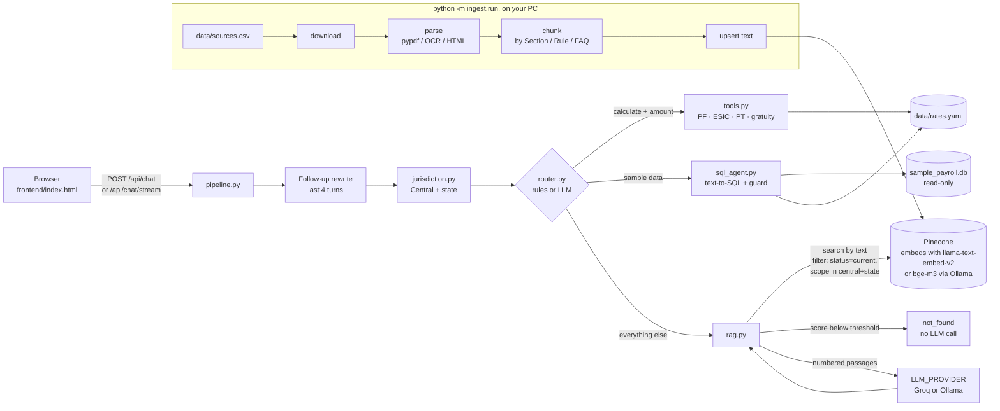

# Compliance Copilot

**Indian payroll and labour-law answers with citations to the official documents.** Ask about PF, ESIC, wages, bonus, gratuity, Professional Tax or TDS on salary. The copilot searches central law plus the right state, answers only from the retrieved passages, cites document and page, runs calculations in plain Python, and says *"not in my documents"* instead of guessing.

A portfolio project by **Cyber Panther**, built as a Learnbay assignment. It runs two ways: **in the cloud for free** (Groq for the language model, Pinecone's hosted embeddings, deployed on Render), or **fully local** with Ollama. See [Two ways to run](#two-ways-to-run).

> For reference only, not legal advice. Figures come only from the cited documents and from `data/rates.yaml`, which you fill in from official circulars.

| Light "Heroic" theme (default) | Dark "Cyber Panther" theme |
|---|---|
|  |  |
|  |  |

<sub>Screenshots are in demo mode: the `[bracketed]` values are placeholders the real backend fills from documents.</sub>

## The problem

Payroll teams answer the same questions every month (is ESIC applicable at this salary, how is PF split, what PT applies in this city) and the rules moved when India's four Labour Codes came into force on 21 Nov 2025, replacing the EPF, ESI, Gratuity, Bonus and Minimum Wages Acts. A general chatbot answers confidently from stale training data. This copilot answers only from documents you index, shows the passage it used, refuses when nothing relevant is found, and knows which Acts are repealed.

## Architecture



| File | What it does |
|---|---|
| `app/main.py` | FastAPI app; serves the frontend at `/` and the API under `/api` |
| `app/pipeline.py` | One chat turn end to end (shared by the API and the eval) |
| `app/jurisdiction.py` | State detection from `data/states.yaml` (same aliases as the frontend) |
| `app/router.py` | Tool / SQL / RAG routing; `ROUTER=llm` uses Qwen's JSON output with a rules fallback |
| `app/rag.py` | Retrieval, re-rank, threshold, prompt, citation cleanup, streaming |
| `app/tools.py` | Calculators; read every figure from `data/rates.yaml` |
| `app/sql_agent.py` | Few-shot text-to-SQL, sqlglot guard, read-only SQLite |
| `app/llm.py` | Groq and Ollama behind one interface (`LLM_PROVIDER`); same prompts, temperature 0.1, max 700 tokens |
| `app/vectorstore.py` | Pinecone with hosted embeddings or with Ollama bge-m3 (`EMBED_PROVIDER`) |
| `app/limits.py` | Public demo guards: per-IP rate limit and the answer cache |
| `app/list_models.py` | `python -m app.list_models` prints the models your key can use |
| `ingest/` | `download → parse → chunk → index`, run with `python -m ingest.run` |
| `eval/` | 33 questions and the metrics runner |

## Two ways to run

| | Cloud (default) | Local |
|---|---|---|
| Language model | Groq API, free tier | Ollama, `qwen2.5:7b` on your PC |
| Embeddings | Pinecone hosted `llama-text-embed-v2` | Ollama `bge-m3` |
| Pinecone index | a new one with integrated embedding, e.g. `compliance-copilot-cloud` | your dense 1024-dim index, e.g. `compliance-copilot` |
| You need | Python, a Groq key, a Pinecone key | Python, Ollama, a Pinecone key |
| `.env` | `LLM_PROVIDER=groq`, `EMBED_PROVIDER=pinecone` | `LLM_PROVIDER=ollama`, `EMBED_PROVIDER=ollama` |

The two embedding modes use different models, so their vectors can't share an index. Switching modes means switching `PINECONE_INDEX` and indexing the documents once for that index. Neither mode deletes or reconfigures an index it didn't create. You can also mix: `LLM_PROVIDER=ollama` with `EMBED_PROVIDER=pinecone` works.

### Cloud mode on Windows (PowerShell)

You need Python 3.11 or newer, a free [Groq](https://console.groq.com/keys) API key and a free [Pinecone](https://app.pinecone.io) API key. No Ollama.

```powershell
# 1. Get the code and create a virtual environment
git clone https://github.com/rushimakwana112-cpu/compliance-copilot-india.git; cd compliance-copilot-india; py -3.11 -m venv .venv; .\.venv\Scripts\Activate.ps1

# 2. Install the app plus the ingestion libraries (PDF parsing runs on your PC, not on the server)
pip install -r requirements-ingest.txt

# 3. Create .env and paste GROQ_API_KEY and PINECONE_API_KEY
Copy-Item .env.example .env; notepad .env

# 4. See which models your Groq key can use, then put one id in GROQ_MODEL in .env
python -m app.list_models

# 5. Index the documents (creates the Pinecone index on the first run)
python -m ingest.run --limit 2

# 6. Start the app, then open http://localhost:8000
uvicorn app.main:app --reload
```

**Picking a model:** `python -m app.list_models` lists the chat models available to your key and marks the Qwen and Llama ones. Prefer a Qwen or Llama model of about 30B parameters or more for answer quality, or a smaller "instant" Llama if you hit the free-tier limits; copy the id exactly. Groq retires and adds models regularly, so the code never hard-codes one. If the model you chose disappears, `/api/health` says so.

### Local mode with Ollama (PowerShell)

```powershell
pip install -r requirements-ingest.txt
ollama pull qwen2.5:7b; ollama pull bge-m3
Copy-Item .env.example .env; notepad .env   # set LLM_PROVIDER=ollama, EMBED_PROVIDER=ollama, PINECONE_INDEX=<your dense index>
python scripts/make_sample_db.py; python -m ingest.run --limit 2
uvicorn app.main:app --reload
```

If the page shows **Needs attention**, hover the status dot or read the notice: `/api/health` says exactly what is missing (no key, a model not set or not pulled, Ollama not running, the wrong index type). If the backend is not running at all, the page runs in **demo mode** with placeholder answers.

Run the tests (no Groq, Ollama or Pinecone needed; all are faked): `pip install -r requirements-dev.txt; python -m pytest`

**Optional OCR for scanned PDFs:** install [Tesseract](https://github.com/UB-Mannheim/tesseract/wiki) and [Poppler](https://github.com/oschwartz10612/poppler-windows/releases), add both to `PATH`, then uncomment the OCR lines in `requirements-ingest.txt` and reinstall. Without them, scanned pages are skipped with a warning.

## Deploy free on Render

The server only answers questions; documents are indexed from your PC into Pinecone, and the deployed app reads the same index. `render.yaml` describes the service, so Render sets most of it up for you.

```powershell
# 1. On your PC, in cloud mode: index the documents and check answers locally first (see above)
python -m ingest.run
python -m eval.run

# 2. Optional: commit the document list so the deployed sidebar shows it (names, URLs and hashes only, no secrets)
git add data/manifest.json; git commit -m "Indexed documents"; git push

# 3. Never commit .env. This must print nothing:
git ls-files .env
```

4. Open [dashboard.render.com](https://dashboard.render.com), choose **New → Blueprint**, connect GitHub and pick `compliance-copilot-india` and the branch to deploy.
5. Render reads `render.yaml` and asks for the four secret values: `GROQ_API_KEY`, `GROQ_MODEL`, `PINECONE_API_KEY` and `PINECONE_INDEX` (the index you ingested into). `PUBLIC_MODE=true`, `LLM_PROVIDER=groq` and `EMBED_PROVIDER=pinecone` are already set. Click **Apply**.
6. When the deploy is live, check it from PowerShell (use your service's URL):

```powershell
$url = "https://compliance-copilot.onrender.com"
Invoke-RestMethod "$url/api/health"            # status ok, provider groq, public_mode True
Invoke-RestMethod "$url/api/chat" -Method Post -ContentType "application/json" -Body '{"message":"Is gratuity payable to a fixed term employee?"}'
try { Invoke-RestMethod "$url/api/ingest/url" -Method Post -ContentType "application/json" -Body '{"url":"https://example.gov.in/a.pdf"}' } catch { $_.Exception.Response.StatusCode }   # Forbidden
```

**What the free plan means:** the service sleeps after about 15 minutes without visitors, and the next visit wakes it, which can take up to a minute. The page shows *"Waking up the server…"* while that happens. The app starts at about 60 MB of RAM (the free instance has 512 MB) because `requirements.txt` holds only the web app; PDF and OCR libraries are in `requirements-ingest.txt` and never installed on Render.

**What public mode does** (`PUBLIC_MODE=true`):

- `/api/ingest/*` returns 403 and the page hides the upload and link boxes.
- Each IP may ask 10 questions a minute and 60 a day; over that, the answer explains the limit (HTTP 429 with `Retry-After`).
- The last 500 answers are cached by question and jurisdiction, so repeated questions cost no Groq tokens.
- Messages are limited to 1,000 characters and history to the last 4 turns.
- When Groq's own free quota runs out, the answer is *"Daily demo limit reached. Please try again later."*
- Keys stay on the server: `/api/health` reports the provider and model, never a key.

## Environment variables

| Variable | Default | What it does |
|---|---|---|
| `LLM_PROVIDER` | `groq` | `groq` (cloud) or `ollama` (local) |
| `GROQ_API_KEY` | | Your Groq key. Secret |
| `GROQ_MODEL` | | A model id from `python -m app.list_models` |
| `OLLAMA_URL` | `http://localhost:11434` | Where Ollama runs |
| `LLM_MODEL` | `qwen2.5:7b` | The Ollama chat model |
| `EMBED_PROVIDER` | `pinecone` | `pinecone` (hosted `llama-text-embed-v2`) or `ollama` (`bge-m3`) |
| `EMBED_MODEL` | `bge-m3` | The Ollama embedding model |
| `PINECONE_API_KEY` | | Your Pinecone key. Secret |
| `PINECONE_INDEX` | `compliance-copilot-cloud` | Index name; created if missing, never modified if it exists |
| `SCORE_THRESHOLD` | `0.38` (pinecone) / `0.55` (ollama) | Below this similarity the answer is "not found" without an LLM call. Leave unset to use the default for your embedding mode |
| `CONTEXT_TOKEN_BUDGET` | `3000` | Estimated tokens of passages per answer (chars ÷ 4). Over it, neighbour context is trimmed, then the lowest-ranked passages are dropped. Keeps each request well under Groq's free ~8,000 tokens/minute |
| `ROUTER` | `rules` | `rules` or `llm` (JSON routing with a rules fallback) |
| `PUBLIC_MODE` | `false` | `true` on the deployed demo (see above) |
| `RATE_LIMIT_PER_MIN` | `10` | Chats per IP per minute in public mode |
| `RATE_LIMIT_PER_DAY` | `60` | Chats per IP per day in public mode |
| `CACHE_SIZE` | `500` | Answers kept in the cache; `0` turns it off |

## How jurisdiction works

1. **Central law is always searched.**
2. **Auto mode** (default): the question is scanned for state names and cities from `data/states.yaml` ("Ahmedabad" → Gujarat, "Pune" → Maharashtra). Whole words only; longest alias first ("New Delhi" before "Delhi"). If none is found, the default state from the sidebar is used.
3. **Manual mode:** only the selected state, whatever the question says.
4. The backend re-runs detection on the message, and on the rewritten question for follow-ups ("and in Pune?"), rather than trusting the browser.
5. The Pinecone filter is `{"status": "current", "scope": {"$in": ["central", "<state>"]}}`. Repealed Acts are searched only when the question asks about them ("the old Gratuity Act"), and an answer that cites one gets a note saying so.
6. **Two states named** ("compare Gujarat and Maharashtra PT"): each state is retrieved separately so neither crowds out the other, and the model is asked for a comparison table.
7. Every response echoes the scope used, and the UI shows it on the answer ("Central + Gujarat").

To add a state or city, edit `data/states.yaml`; the frontend loads it from `GET /api/states`.

## How to add a document

**From the UI:** upload a PDF (max 20 MB) or paste an `https` link in the sidebar. It is indexed in the background; the sidebar shows "indexing…" until it's done. Uploads are tagged with the current state and `status: current`.

**In bulk (recommended for official sources):** add a row to `data/sources.csv`

```csv
url,doc,scope,status,effective_date,doc_type
https://…/notification.pdf,"ESIC wage-ceiling notification",central,current,2025-11-21,notification
```

then run `python -m ingest.run --only "ESIC"`. Files are downloaded once into `data/raw/` with their sha256 in `data/manifest.json`. Re-running is safe: unchanged files are skipped, and a changed file's old vectors are deleted before re-indexing (preview with `--dry-run`). After a change to the chunking, run `python -m ingest.run --reindex`: it deletes every document's old vectors and indexes it again, including PDFs uploaded from the sidebar. `scope` is `central` or a state id; `status` is `current`, `repealed` or `historical`.

**Rates for the calculators** live only in `data/rates.yaml`. Each figure is a list of dated versions (`value`, `effective_from`, `effective_to`, `source_doc`, `section`, `status`). Calculators use the version valid today, or on a date written in the question ("PF for basic 20000 on 1 March 2026"), and the PF answer names the wage ceiling and notification it used. A `null` value answers *"Rate not configured: <field>"*. The shipped file has only the two PF wage ceilings (₹15,000 historical, ₹25,000 from the Gazette notification of 17 Sept 2026); everything else is `null` until filled from the official document. `GET /api/rates` shows every figure as it applies today (`?on=YYYY-MM-DD` for another date).

## API

| Endpoint | Purpose |
|---|---|
| `GET /api/health` | `{status, model, provider, embed_provider, llm_ok, pinecone, docs, public_mode, issues[]}`. Checks the Groq key with a free models-list call |
| `GET /healthz` | `{ok: true}` with no outside calls, for Render's health check |
| `GET /api/documents` | `[{name, scope, status, meta}]`: indexed, indexing and planned documents |
| `GET /api/states` | `[{id, name, aliases[]}]` |
| `POST /api/chat` | `{message (≤ 1,000 chars), history[] (last 4 turns used), jurisdiction}` → `{type: rag\|tool\|sql\|not_found\|error, answer, scope, citations[], table?, tool?, sql?, rows_scanned?, note?, latency_ms, cached?, quota_exceeded?}`. In public mode, 429 with the same shape when the IP is over its limit |
| `POST /api/chat/stream` | Server-Sent Events: `meta`, then `token`…, then `done` with the same JSON as `/api/chat` |
| `POST /api/ingest/file` | multipart `file` (PDF ≤ 20 MB) + `scope`; indexes in the background. 403 in public mode |
| `POST /api/ingest/url` | `{url (https), scope}`; downloads and indexes in the background. 403 in public mode |
| `POST /api/feedback` | appends to `logs/feedback.jsonl` (thumbs-down questions are eval candidates) |

Every chat is logged to `logs/chats.jsonl` with the scope, route, outcome and latency, plus the retrieval details for every route: the Pinecone index, the filters used, the top 5 scores and the doc and section of each retrieved chunk (empty, with `"retrieval": "not run"`, for calculator and SQL answers). `type: error` means the search itself failed (Pinecone unreachable, not configured, or 0 matches, which points to a wrong index or filter); it is logged as a WARNING and shown as *"Search failed: …"* instead of a silent *not found*.

Follow-ups are rewritten into a standalone question only when they clearly are one: they start with *and*, *what about*, *same for* and similar, or lean on *it/that/this/there* without naming their own topic. *"Gratuity rule in Dubai?"* is used exactly as typed.

## Evaluation

`eval/questions.csv` has 33 questions: 19 RAG (5 follow-ups), 5 calculator, 4 SQL and 5 trick questions that must be refused. In `expected_answer_contains`, `a|b` means any of and `a&b` means all of, so q31 checks that the wages definition includes both what wages include and what they exclude.

`requires_doc` names the documents a question needs (same `|` / `&` syntax, matched against names in `data/manifest.json`). If they are not indexed, the question is reported as *skipped (doc not ingested)* instead of failed. On Groq's free tier the eval waits `--delay` seconds between questions (default 8). A question refused for a rate limit is asked once more after the provider's retry-after (up to `--max-wait`, default 90 s), then reported as *skipped (rate limited)*. Skipped questions are left out of every metric. The report header shows `GROQ_MODEL` and the average prompt tokens of the RAG answers.

```powershell
python -m eval.run --sweep 0.34,0.38,0.42,0.47
```

| Metric | Result |
|---|---|
| Route accuracy | _run the eval_ |
| Retrieval hit@4 | _run the eval_ |
| Answer contains | _run the eval_ |
| not_found precision / recall | _run the eval_ |
| Median latency | _run the eval_ |

**Why the Pinecone threshold is only 0.38.** With `llama-text-embed-v2`, similarity scores for relevant and irrelevant questions overlap. In real tests, *"What is a fixed term employee?"* scored 0.43 although the Code defines the term, while *"Gratuity rule in Dubai?"* scored above 0.47 and was refused correctly by the model. No single threshold separates those, so the threshold now only blocks clear nonsense and the real guards are elsewhere: questions about foreign places are refused before retrieval, a chunk that defines the question's term is always sent to the model, and the model must answer exactly NOT_FOUND when the passages don't answer the question.

**Re-tune after switching embedding models.** `llama-text-embed-v2` and `bge-m3` score on different scales, so a threshold that works for one can refuse too much, or too little, with the other. Run the sweep once per mode.

**Tuning log** (fill in as you tune): which `SCORE_THRESHOLD` and chunk size you started with, what the sweep showed, and what you changed. Defaults: threshold 0.38 for Pinecone embeddings and 0.55 for bge-m3; one chunk per defined term in Definitions sections (up to ~3,000 characters), other chunks up to ~1,800 characters with 200 overlap, cut only between sub-clauses; Schedules and end matter (Statement of Objects and Reasons, Notes on Clauses) get their own labels, and end matter is indexed as `commentary` and ranked 0.10 lower; top_k 12 → re-rank → keep 5, each with up to 600 characters of its neighbouring chunks on each side, capped at ~3,000 prompt tokens. Answers list only the passages they cite; the rest appear under "Other passages searched".

## Limitations

- **Not legal advice.** Answers are only as good as the indexed documents; always open the cited source.
- Figures come only from cited documents and `data/rates.yaml`; nothing is hard-coded, so an empty `rates.yaml` means no calculations.
- Professional Tax is modelled as simple monthly slabs. Rules such as Maharashtra's gender-based slabs or a higher February deduction need extra fields.
- The SQL agent works on the synthetic sample table only; it never sees real employee data.
- A 7B local model can still misread a passage. The threshold, citation cleanup and NOT_FOUND rule reduce this but don't remove it.
- Scanned PDFs need Tesseract and Poppler for OCR.
- The public demo's rate limit and cache live in memory: a restart resets them, and the per-IP count trusts the first `X-Forwarded-For` address, which a determined user can fake. Groq's own free-tier limit is the real ceiling.
- Groq's free tier has per-minute and per-day token limits; a busy demo will hit them and answer with the daily-limit message.

## Future work

- Hybrid search (BM25 + vectors) so exact section numbers like "Section 53" match reliably.
- A cross-encoder re-ranker in place of the simple score + doc-type boost.
- Per-document "last checked" dates and alerts when an official URL changes its hash.
- More state rules (Shops & Establishments, state rules under the Codes) and a TDS calculator.
- Feed thumbs-down questions from `logs/feedback.jsonl` into the eval set automatically.
- Keep the rate limit and cache in a small Redis so they survive restarts and work across several instances.

## Project structure

```
app/        FastAPI app and the answer pipeline
ingest/     download → parse → chunk → index
frontend/   index.html (single file, no framework)
data/       sources.csv, rates.yaml, states.yaml, sql_examples.yaml, sample_payroll.db
eval/       questions.csv, run.py, report.md
tests/      pytest suite with fake Groq, Ollama and Pinecone
render.yaml                Render Blueprint for the free web service
requirements.txt           the web app only (what Render installs)
requirements-ingest.txt    + PDF parsing and the ingestion CLI (your PC)
requirements-dev.txt       + pytest
scripts/    make_sample_db.py
docs/       build-log.md (what each build step teaches), screenshots/
```

## License

MIT, see [LICENSE](LICENSE).
