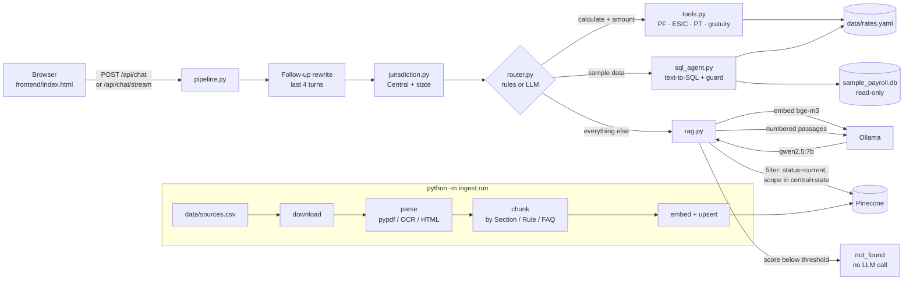

# Compliance Copilot

**Indian payroll and labour-law answers with citations to the official documents.** Ask about PF, ESIC, wages, bonus, gratuity, Professional Tax or TDS on salary. The copilot searches central law plus the right state, answers only from the retrieved passages, cites document and page, runs calculations in plain Python, and says *"not in my documents"* instead of guessing.

A portfolio project by **Cyber Panther**, built as a Learnbay assignment. Everything runs locally: Ollama for the language model, Pinecone's free tier for vectors.

> For reference only, not legal advice. Figures come only from the cited documents and from `data/rates.yaml`, which you fill in from official circulars.

| Light "Heroic" theme (default) | Dark "Cyber Panther" theme |
|---|---|
|  |  |
|  |  |

<sub>Screenshots are in demo mode: the `[bracketed]` values are placeholders the real backend fills from documents.</sub>

## The problem

Payroll teams answer the same questions every month (is ESIC applicable at this salary, how is PF split, what PT applies in this city) and the rules moved when India's four Labour Codes came into force on 21 Nov 2025, replacing the EPF, ESI, Gratuity, Bonus and Minimum Wages Acts. A general chatbot answers confidently from stale training data. This copilot answers only from documents you index, shows the passage it used, refuses when nothing relevant is found, and knows which Acts are repealed.

## Architecture



| File | What it does |
|---|---|
| `app/main.py` | FastAPI app; serves the frontend at `/` and the API under `/api` |
| `app/pipeline.py` | One chat turn end to end (shared by the API and the eval) |
| `app/jurisdiction.py` | State detection from `data/states.yaml` (same aliases as the frontend) |
| `app/router.py` | Tool / SQL / RAG routing; `ROUTER=llm` uses Qwen's JSON output with a rules fallback |
| `app/rag.py` | Retrieval, re-rank, threshold, prompt, citation cleanup, streaming |
| `app/tools.py` | Calculators; read every figure from `data/rates.yaml` |
| `app/sql_agent.py` | Few-shot text-to-SQL, sqlglot guard, read-only SQLite |
| `app/llm.py`, `app/vectorstore.py` | Thin Ollama and Pinecone clients behind small interfaces |
| `ingest/` | `download → parse → chunk → index`, run with `python -m ingest.run` |
| `eval/` | 30 questions and the metrics runner |

## Setup on Windows (PowerShell)

You need Python 3.11, [Ollama](https://ollama.com) and a free [Pinecone](https://www.pinecone.io) API key.

```powershell
# 1. Get the code and create a virtual environment
git clone https://github.com/rushimakwana112-cpu/compliance-copilot-india.git; cd compliance-copilot-india; py -3.11 -m venv .venv; .\.venv\Scripts\Activate.ps1

# 2. Install Python packages
pip install -r requirements.txt

# 3. Pull the two models (Ollama must be running)
ollama pull qwen2.5:7b; ollama pull bge-m3

# 4. Create .env, then open it and paste your PINECONE_API_KEY
Copy-Item .env.example .env; notepad .env

# 5. Build the sample database and index the first two documents
python scripts/make_sample_db.py; python -m ingest.run --limit 2

# 6. Start the app, then open http://localhost:8000
uvicorn app.main:app --reload
```

If the page shows **Needs attention**, hover the status dot or read the notice: `/api/health` says exactly what is missing (Ollama not running, a model not pulled, no Pinecone key). If the backend is not running at all, the page runs in **demo mode** with placeholder answers.

Run the tests (no Ollama or Pinecone needed; both are faked): `python -m pytest`

**Optional OCR for scanned PDFs:** install [Tesseract](https://github.com/UB-Mannheim/tesseract/wiki) and [Poppler](https://github.com/oschwartz10612/poppler-windows/releases), add both to `PATH`, then `pip install pytesseract pdf2image`. Without them, scanned pages are skipped with a warning.

## How jurisdiction works

1. **Central law is always searched.**
2. **Auto mode** (default): the question is scanned for state names and cities from `data/states.yaml` ("Ahmedabad" → Gujarat, "Pune" → Maharashtra). Whole words only; longest alias first ("New Delhi" before "Delhi"). If none is found, the default state from the sidebar is used.
3. **Manual mode:** only the selected state, whatever the question says.
4. The backend re-runs detection on the message, and on the rewritten question for follow-ups ("and in Pune?"), rather than trusting the browser.
5. The Pinecone filter is `{"status": "current", "scope": {"$in": ["central", "<state>"]}}`. Repealed Acts are searched only when the question asks about them ("the old Gratuity Act"), and an answer that cites one gets a note saying so.
6. **Two states named** ("compare Gujarat and Maharashtra PT"): each state is retrieved separately so neither crowds out the other, and the model is asked for a comparison table.
7. Every response echoes the scope used, and the UI shows it on the answer ("Central + Gujarat").

To add a state or city, edit `data/states.yaml`; the frontend loads it from `GET /api/states`.

## How to add a document

**From the UI:** upload a PDF (max 20 MB) or paste an `https` link in the sidebar. It is indexed in the background; the sidebar shows "indexing…" until it's done. Uploads are tagged with the current state and `status: current`.

**In bulk (recommended for official sources):** add a row to `data/sources.csv`

```csv
url,doc,scope,status,effective_date,doc_type
https://…/notification.pdf,"ESIC wage-ceiling notification",central,current,2025-11-21,notification
```

then run `python -m ingest.run --only "ESIC"`. Files are downloaded once into `data/raw/` with their sha256 in `data/manifest.json`. Re-running is safe: unchanged files are skipped, and a changed file's old vectors are deleted before re-indexing (preview with `--dry-run`). `scope` is `central` or a state id; `status` is `current`, `repealed` or `historical`.

**Rates for the calculators** live only in `data/rates.yaml`. Each value has `source_doc` and `effective_date`; the shipped file has every value as `null`, so calculators answer *"rate not configured"* until you fill them from the official circular.

## API

| Endpoint | Purpose |
|---|---|
| `GET /api/health` | `{status, model, pinecone, docs, ollama, issues[]}` |
| `GET /api/documents` | `[{name, scope, status, meta}]`: indexed, indexing and planned documents |
| `GET /api/states` | `[{id, name, aliases[]}]` |
| `POST /api/chat` | `{message, history[], jurisdiction}` → `{type: rag\|tool\|sql\|not_found, answer, scope, citations[], table?, tool?, sql?, rows_scanned?, note?, latency_ms}` |
| `POST /api/chat/stream` | Server-Sent Events: `meta`, then `token`…, then `done` with the same JSON as `/api/chat` |
| `POST /api/ingest/file` | multipart `file` (PDF ≤ 20 MB) + `scope`; indexes in the background |
| `POST /api/ingest/url` | `{url (https), scope}`; downloads and indexes in the background |
| `POST /api/feedback` | appends to `logs/feedback.jsonl` (thumbs-down questions are eval candidates) |

Every chat is logged to `logs/chats.jsonl` with the scope, route, top scores and latency.

## Evaluation

`eval/questions.csv` has 30 questions: 16 RAG (5 follow-ups), 5 calculator, 4 SQL and 5 trick questions that must be refused.

```powershell
python -m eval.run --sweep 0.45,0.5,0.55,0.6,0.65
```

| Metric | Result |
|---|---|
| Route accuracy | _run the eval_ |
| Retrieval hit@4 | _run the eval_ |
| Answer contains | _run the eval_ |
| not_found precision / recall | _run the eval_ |
| Median latency | _run the eval_ |

**Tuning log** (fill in as you tune): which `SCORE_THRESHOLD` and chunk size you started with, what the sweep showed, and what you changed. Defaults: threshold 0.55, chunks of 1,000 characters with 150 overlap, top_k 8 → keep 4.

## Limitations

- **Not legal advice.** Answers are only as good as the indexed documents; always open the cited source.
- Figures come only from cited documents and `data/rates.yaml`; nothing is hard-coded, so an empty `rates.yaml` means no calculations.
- Professional Tax is modelled as simple monthly slabs. Rules such as Maharashtra's gender-based slabs or a higher February deduction need extra fields.
- The SQL agent works on the synthetic sample table only; it never sees real employee data.
- A 7B local model can still misread a passage. The threshold, citation cleanup and NOT_FOUND rule reduce this but don't remove it.
- Scanned PDFs need Tesseract and Poppler for OCR.

## Future work

- Hybrid search (BM25 + vectors) so exact section numbers like "Section 53" match reliably.
- A cross-encoder re-ranker in place of the simple score + doc-type boost.
- Per-document "last checked" dates and alerts when an official URL changes its hash.
- More state rules (Shops & Establishments, state rules under the Codes) and a TDS calculator.
- Feed thumbs-down questions from `logs/feedback.jsonl` into the eval set automatically.

## Project structure

```
app/        FastAPI app and the answer pipeline
ingest/     download → parse → chunk → index
frontend/   index.html (single file, no framework)
data/       sources.csv, rates.yaml, states.yaml, sql_examples.yaml, sample_payroll.db
eval/       questions.csv, run.py, report.md
tests/      pytest suite with fake Ollama and Pinecone
scripts/    make_sample_db.py
docs/       build-log.md (what each build step teaches), screenshots/
```

## License

MIT, see [LICENSE](LICENSE).
